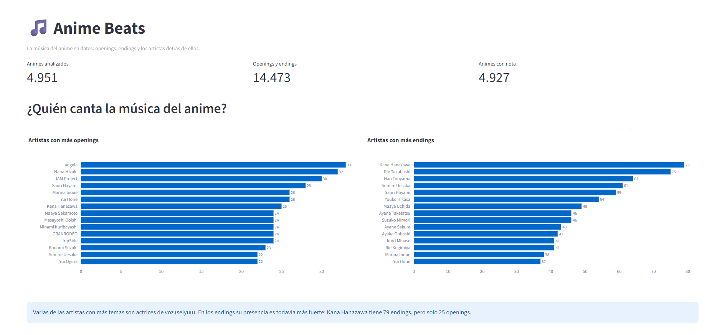

# 🎵 Anime Beats

**Análisis de datos de la música del anime: openings, endings y los artistas detrás de ellos.**

👉 **[Ver el dashboard interactivo](https://anime-beats-isaac.streamlit.app/)**



## ¿De qué trata?

Analicé cerca de 5.000 animes y más de 14.000 temas musicales para responder preguntas como:

- ¿Qué artistas han cantado más openings y endings?
- ¿Cómo ha cambiado la música del anime a lo largo de los años?
- ¿Los animes con más música son mejor evaluados?
- ¿Qué géneros tienen mejor nota?
- ¿Qué artistas cantan en los animes mejor evaluados?

## Principales hallazgos

1. **Las actrices de voz dominan los endings.** Kana Hanazawa tiene 79 endings, pero solo 25 openings. En el anime es común que las voces de los personajes también canten los temas.
2. **Los endings superan a los openings desde 2005.** Hasta el año 2000 había casi la misma cantidad de ambos; en 2018 hubo más de 500 endings y menos de 300 openings.
3. **Más música no significa mejor anime.** Los animes con más temas tienen mejor nota (de 64,9 a 71,5), pero también son mucho más largos (de 10 a 46 episodios en promedio). Las series exitosas se renuevan y acumulan más temas: correlación no implica causalidad.
4. **Los géneros "serios" son los mejor evaluados.** Thriller (73,6), Psychological (73,2) y Drama (71,7) lideran, mientras que los géneros masivos como Comedy y Action quedan en la mitad.
5. **Cantidad no es lo mismo que calidad.** Los artistas con más temas no son los de los animes mejor evaluados. Ahí lideran bandas como Linked Horizon, milet, SPYAIR y YOASOBI, aunque varios trabajan con una sola franquicia exitosa.

El análisis completo, con las precauciones de cada resultado, está en [HALLAZGOS.md](HALLAZGOS.md).

## Tecnologías

| Etapa | Herramientas |
|---|---|
| Extracción de datos | Python, `requests`, APIs REST y GraphQL |
| Limpieza y transformación | `pandas` |
| Consultas y validación | SQL en Google BigQuery |
| Visualización | Streamlit y Plotly |

## Fuentes de datos

- **[AnimeThemes](https://animethemes.moe/):** openings, endings y artistas de cada anime.
- **[AniList](https://anilist.co/):** notas, popularidad, géneros y episodios.

Ambas fuentes se unieron con el ID de MyAnimeList, logrando un 99,7% de coincidencia (4.927 de 4.940 animes).

Primero intenté usar la API de Jikan (MyAnimeList), pero respondía con errores constantes, así que cambié a AniList, que además permite pedir 50 animes por consulta.

## Estructura del proyecto

```
anime-beats/
├── app.py                      ← dashboard de Streamlit
├── src/
│   ├── descargar_temas.py      ← descarga openings y endings (AnimeThemes)
│   ├── descargar_anilist.py    ← descarga notas y géneros (AniList)
│   ├── transformar.py          ← convierte el JSON en tablas
│   ├── transformar_anilist.py
│   ├── analisis.py             ← primeros análisis con pandas
│   └── musica_vs_nota.py
├── sql/                        ← consultas SQL usadas en BigQuery
├── data/processed/             ← tablas limpias (CSV)
├── HALLAZGOS.md
└── requirements.txt
```

## Cómo ejecutarlo

```
pip install -r requirements.txt

# (Opcional) volver a descargar y procesar los datos
python src/descargar_temas.py
python src/transformar.py
python src/descargar_anilist.py
python src/transformar_anilist.py

# Abrir el dashboard
streamlit run app.py
```

## Limitaciones

- Algunos temas no tienen artista registrado, así que los rankings de artistas pueden estar incompletos.
- Los años más recientes pueden estar incompletos en la base de datos, porque es mantenida por voluntarios.
- Se excluyó el contenido para adultos del análisis de géneros.

## Autor

**Isaac Andrade** · [GitHub](https://github.com/Isaac-Andrade970)